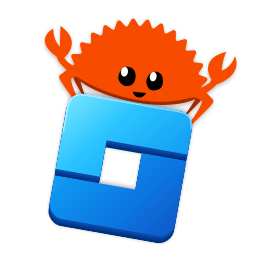
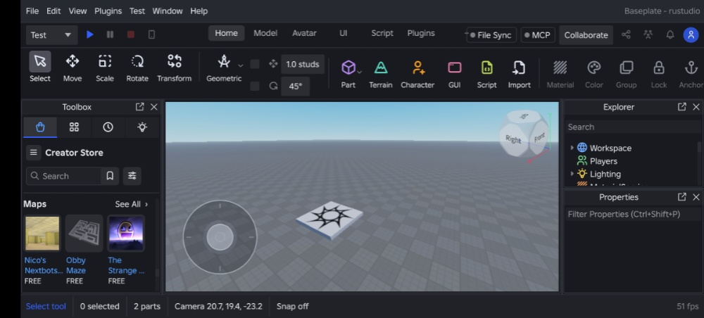
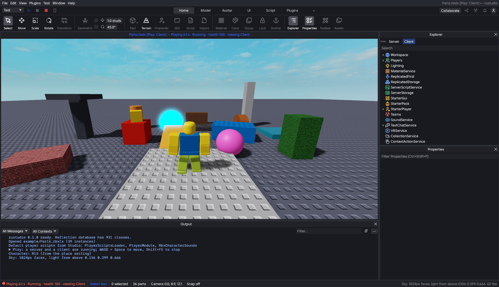

<p align="center">
  
</p>

<h1 align="center">rustudio (Android)</h1>

<p align="center">
  <a href="https://discord.gg/8EX6cpgsRx"></a>
</p>

**A native Android Roblox Studio, written in Rust.** Open, edit and save
Roblox places, press Play and run them with real Luau, physics, characters,
touch controls, and GUIs, directly on your Android device.

> [!NOTE]
> **Credits & Upstream Notice:**
> - Full credit to **[rippelz](https://github.com/rippelz/rustudio)** and **[TouseefX](https://github.com/TouseefX/rustudio)** for their foundational work and development on rustudio!
> - The **PC / desktop version** (Linux, Windows, macOS) is handled and maintained upstream by **[rippelz/rustudio](https://github.com/rippelz/rustudio)**. This repository focuses specifically on the Android port.

Rustudio is very much a beta/prototype on Android, but provides a portable Roblox Studio experience in your pocket.





> Contributions are super welcome — **please read [CONTRIBUTING.md](CONTRIBUTING.md) before contributing** so your PR follows our architecture, mobile rules, and test checklist. Come hang out, ask for help or report bugs on the [Discord](https://discord.gg/8EX6cpgsRx).

## Features

- **Android Mobile UI (`com.logosforgestudios.rustudio`):** Native Vulkan/GLES3 mobile build with touch-friendly floating collapsible panels for Explorer, Properties, Output, and Toolbox.
- **Touch Controls:** Edit-mode virtual joystick, touch-look camera controls, and pinch-to-zoom gestures with clean multi-touch isolation so UI panels never leak into 3D navigation.
- **Graphics & Performance:** Full user-controlled graphics settings with native Vulkan 1.1+ and OpenGL ES 3.0+ backends, tile-memory optimized render passes, SSAO, shadows, and a live performance overlay (see [docs/ANDROID.md](docs/ANDROID.md)).
- **Editor:** Explorer, Properties, Output, script tabs, move/scale/rotate tools with drag duplication and selection rotation, pop-out panels, terrain brushes, threaded generation, and undo/redo.
- **Files:** `.rbxl` / `.rbxlx` places and `.rbxm` / `.rbxmx` models, plus project folders (`*.project.json` with Rojo/Argon sync rules, `sourcemap.json`).
- **Roblox Destinations:** Save to Roblox As and Publish As using your signed-in account. Browse personal, shared and group experiences in a searchable grid.
- **Toolbox & Plugins:** Search the Creator Store, your Inventory, Recent, and Creations; insert models, meshes, images, audio, and run Roblox Studio plugins.
- **Play / Run:** Run places with separate server and client, remotes, physics solver, R15/R6 characters with climbing and held jump, sounds, tweens, and 2D/3D GUIs.
- **Luau:** Real Luau VM with extensive engine API coverage (see [docs/ENGINE-GAPS.md](docs/ENGINE-GAPS.md)).
- **Roblox Account:** Open your cloud places, load assets and avatars, use DataStores, and join Team Create sessions.

## Download & Install

Prebuilt APKs (`arm64-v8a` for physical devices, `x86_64` for emulators) are available on the [Releases page](https://github.com/GoyDevv/Rustudio-Android/releases).

### Installing the APK

- **On Device:** Download `rustudio-android-arm64-v8a.apk` to your phone or tablet and open it to install.
- **Via ADB:**
  ```bash
  adb install rustudio-android-arm64-v8a.apk
  ```
- For Android emulators on PC, install `rustudio-android-x86_64.apk`.

> **Looking for the PC version?** Prebuilt desktop binaries for Linux, Windows, and macOS are maintained upstream by **[rippelz/rustudio](https://github.com/rippelz/rustudio/releases)**.

### Building from Source

To build the Android APK from source, you need a stable Rust toolchain (1.95+) and Android NDK/SDK setup:

```bash
# Add Android target
rustup target add aarch64-linux-android

# Install xbuild
cargo install xbuild

# Build release APK
CARGO_PROFILE_RELEASE_LTO=thin x build -p rustudio-android --platform android --arch arm64 --format apk --release
```

Detailed instructions for Android NDK/SDK setup, touch input architecture, and device debugging can be found in [docs/ANDROID.md](docs/ANDROID.md).

## Platforms

| Platform | Target Architecture | Graphics API | Status |
|---|---|---|---|
| Android Physical Devices | `arm64-v8a` | Vulkan 1.1+ / OpenGL ES 3.0+ | Supported |
| Android Emulator | `x86_64` | Vulkan / OpenGL ES 3.0+ | Supported |
| PC (Linux, Windows, macOS) | `x86_64` / Apple Silicon | Vulkan / Metal / DX12 | Handled by [rippelz/rustudio](https://github.com/rippelz/rustudio) |

## Signing in

Everything works signed out. To open your cloud places or load private assets, sign in with your Roblox session: tap the account button at the top right and choose **Sign in with your browser** (rustudio displays a code that you confirm on roblox.com in your mobile browser) or supply a `.ROBLOSECURITY` cookie. Details are in [docs/AUTH.md](docs/AUTH.md).

## Credits & Acknowledgements

- **[rippelz/rustudio](https://github.com/rippelz/rustudio)**: Creator of the original rustudio project, handling the PC/desktop edition.
- **[TouseefX/rustudio](https://github.com/TouseefX/rustudio)**: Major developer and contributor to rustudio.
- See [CREDITS.md](CREDITS.md) for full asset attributions, licenses, and vendored crate references.

## Contributing

Interested in contributing? **Please read [CONTRIBUTING.md](CONTRIBUTING.md) first** — it covers Android build setup, mobile engineering rules, required test checklists, and pull request guidelines.

## Docs

- [docs/ANDROID.md](docs/ANDROID.md): Android build, touch controls, and mobile architecture.
- [CONTRIBUTING.md](CONTRIBUTING.md): How to contribute, mobile/graphics rules, and PR checklist.
- [docs/DEVELOPING.md](docs/DEVELOPING.md): Workspace layout, command-line options, and tests.
- [docs/MECHANICS.md](docs/MECHANICS.md): Every tuning number and where it comes from.
- [docs/ENGINE-GAPS.md](docs/ENGINE-GAPS.md): Missing Luau engine API tracker.
- [docs/TEAMCREATE.md](docs/TEAMCREATE.md): Team Create protocol and networking.

## Not affiliated with Roblox

rustudio is an independent project. It is not made, endorsed or supported by Roblox Corporation. "Roblox" and "Roblox Studio" are trademarks of Roblox Corporation.

This repository doesn't redistribute Roblox Studio or its content. Studio's built-in content (fonts, textures, avatar parts, `ReflectionMetadata.xml`) is downloaded from Roblox's CDN on first launch and is never redistributed here.

## License

MIT OR Apache-2.0, at your option. Vendored crates in `vendor/` keep their own licences.
